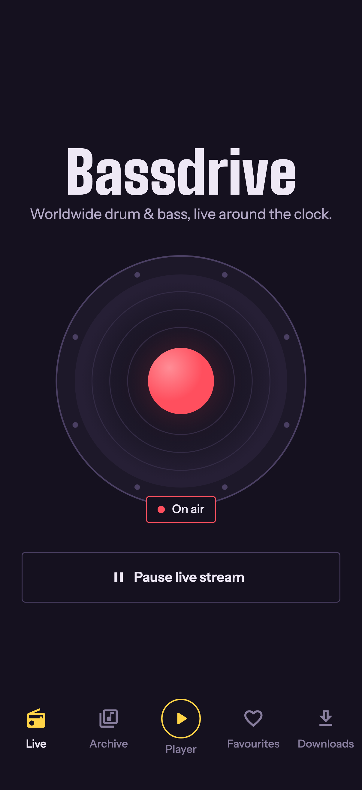
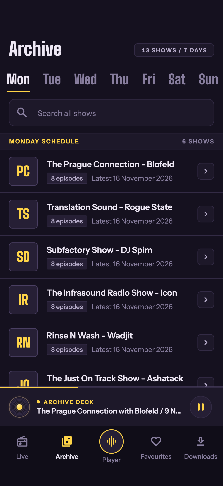
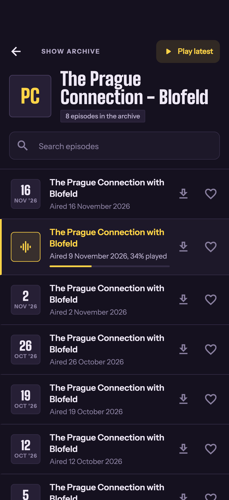
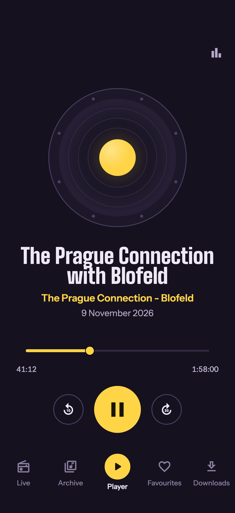
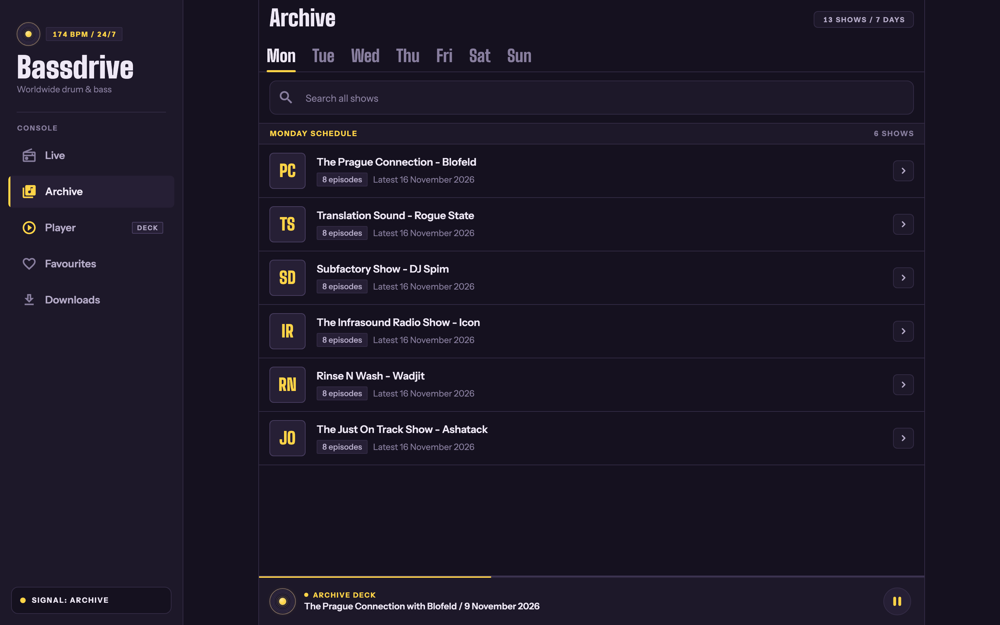

# Bassdrive Radio App

A cross-platform application for listening to Bassdrive Internet radio (24/7 Drum & Bass) and archived shows. Built with Flutter for iOS, Android, macOS, Windows, and Linux.

[](https://github.com/v3rm0n/bassdrive-app/releases/latest)
[](https://github.com/v3rm0n/bassdrive-app/actions)

## Downloads

[](https://github.com/v3rm0n/bassdrive-app/releases/latest/download/app-release.apk)
[](https://github.com/v3rm0n/bassdrive-app/releases/latest/download/Bassdrive-Radio-macOS.dmg)
[](https://github.com/v3rm0n/bassdrive-app/releases/latest/download/Bassdrive-Radio-Windows.zip)
[](https://github.com/v3rm0n/bassdrive-app/releases/latest/download/Bassdrive-Radio-Linux.tar.gz)

<p float="left">
  
   
  
  
</p>



## Features

- **24/7 Live Broadcast**: Stream Bassdrive's round-the-clock Drum & Bass radio feed with live show metadata and a 174 BPM beat-reactive speaker cone
- **Weekly Rotation Archive**: Browse archived shows grouped by broadcast day (Monday–Sunday), opening automatically on today's schedule with instant cross-schedule search
- **Show & Episode Decks**: Explore show archives with a quick **Play latest** action, date-stamped episode rows, air-date metadata, and episode search
- **Persistent Now-Playing Dock**: Control active live or archive playback from an always-accessible deck while browsing Archive, Favourites, or Downloads
- **Progress & History Tracking**: Automatically saves your playback position every 5 seconds, resumes where you left off, and marks completed episodes
- **Favourites Crate**: Bookmark episodes from any list or directly from the full player deck, with instant search and horizontal sort/show filter pills
- **Offline Storage Vault**: Automatically caches played episodes for offline listening, with manual download support and a 2.0 GB storage capacity meter
- **Session Telemetry**: Track total listening time and percentage split between the live stream and archived shows
- **Background Playback**: Continue listening with native lock-screen and media notification controls
- **Adaptive Cross-Platform Design**: Bundled offline typography (`Big Shoulders` + `Instrument Sans`), mobile bottom navigation, and a desktop studio console layout

## Getting Started

### Prerequisites

- Flutter SDK (3.10.0 or higher)
- Dart SDK (3.0.0 or higher)
- Android Studio / Xcode (for mobile builds and simulators)

### Installation

```bash
git clone https://github.com/v3rm0n/bassdrive-app.git
cd bassdrive-app
flutter pub get
```

### Running the App

```bash
# iOS
flutter run -d ios

# Android
flutter run -d android

# macOS
flutter run -d macos

# Windows
flutter run -d windows

# Linux
flutter run -d linux
```

### Building for Production

```bash
# iOS
flutter build ios --release

# Android
flutter build apk --release
# or
flutter build appbundle --release

# macOS
flutter build macos --release

# Windows
flutter build windows --release

# Linux
flutter build linux --release
```

## Architecture

The app is built using:

- **Flutter**: Cross-platform UI framework (Material 3 dark theme with custom broadcast theme extensions)
- **just_audio** & **just_audio_background**: Audio streaming, offline file playback, and media notification controls
- **audio_service**: Background audio handling
- **dio**: HTTP client for archive API requests, live metadata polling, and episode downloads
- **shared_preferences**: Local persistence for listening progress, favourites, downloads index, and telemetry
- **google_fonts**: Bundled offline `Big Shoulders` and `Instrument Sans` font families
- **Service-oriented + ChangeNotifier**: Reactive state management across playback, downloads, and storage

### Project Structure

```
lib/
├── main.dart                 # App entry point and root navigation shell
├── models/                   # API and local state data models
├── services/                 # Playback, archive API, download, and storage services
├── screens/                  # Live, Archive, Show Detail, Favourites, Downloads, and Stats screens
├── ui/
│   ├── player/               # Speaker cone, live badge, timeline, and transport primitives
│   └── theme/                # Design tokens and ThemeExtension definitions
├── widgets/                  # Adaptive navigation, full player, mini player dock, and list items
└── utils/                    # Theme configuration and platform detection utilities
```

## Data Source

The app uses the Bassdrive JSON API:
- API endpoint: `https://bd.maido.io/api.json`
- Live stream URL is sourced from the API `live` field
- Archive data is sourced from the API `archive` field

## Platform Support

### Mobile (iOS & Android)
- Bottom navigation bar with prominent center Player deck button
- Persistent Now-Playing transport dock across browse tabs
- Touch-optimized controls and swipe-to-delete download management

### Desktop (macOS, Windows & Linux)
- 264px studio console sidebar with live speaker indicator and signal status footer
- 960px readable rack column with persistent bottom transport dock
- Mouse and keyboard friendly layout scaling

## Permissions

### iOS
- Audio background mode (for playback when app is in background)

### Android
- Internet access
- Wake lock (prevent sleep during playback)
- Foreground service (for background playback)

### macOS
- Network client entitlement (for API and streaming)
- App Transport Security configured for HTTP streams
- App sandbox enabled

### Linux
- No special permissions required
- Tested on Ubuntu 22.04+
- Requires GTK3 development libraries for building

## Contributing

Contributions are welcome! Please feel free to submit a Pull Request.

## License

This project is open source and available under the MIT License.

## Acknowledgments

- [Bassdrive.com](https://bassdrive.com) for the 24/7 Drum & Bass radio stream
- The Flutter team for the framework
- All the DJs and shows featured in the archive

## Support

For issues, release history, or feature requests, see [GitHub Releases](https://github.com/v3rm0n/bassdrive-app/releases) or open an issue on GitHub.
